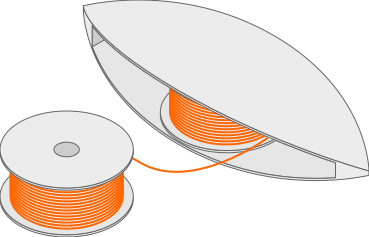

# Tatting Shuttle Set

A 3D-printable tatting shuttle that prints flat and glues into the classic boat shape, so it needs no supports and has no layer lines across the thread path. The set includes a two-part press-fit bobbin and five picot gauges. The shuttle is parametric — set your own size, and match it to your printer.

<!-- Replace with a real photo of the printed set -->

## Get it / print it

- **Source and files**: https://github.com/arnoesterhuizen/tatting-shuttle-set (this repository)
- **MakerWorld** (customizable in-browser): coming soon
- **Printables**: coming soon

## Why this exists

A tatting shuttle is a boat shape — two curved blades that taper to points. That curve is a problem to 3D print. Laid flat, the top surface is a shallow dome that needs supports or comes out stepped with layer lines, right where the thread runs and smoothness matters. Stood up, it is worse.

Inspiration struck when I remembered the [Hairy Lion](https://www.thingiverse.com/thing:2007221), where you print a cylinder with radiating strands, then use a hair dryer to turn it into a realistic mane. The penny dropped on the idea that an object coming off the print bed isn't necessarily in its final shape. Playing around with that idea, I experimented and eventually landed on what we see here.

So the shuttle prints as two flat blades that you glue together, and wedges at the end help shape a curve. To help keep the two blades square without gluing my fingers to the shuttle, I added locating features on the wedges. Lugs in the middle keep the bobbin in place, while the blades provide enough friction to keep everything from unwinding — loose enough that a slight pull unspools more thread. The wedges on the ends and the bobbin in the middle create enough tension to bend the shuttle into a boat curve.

The full design rationale and every parameter is in [docs/parameters.md](docs/parameters.md).

## What's in the set

| Part | Qty | Assembly |
|---|---|---|
| Shuttle blade | 2 | Glue together (CA glue) |
| Bobbin half | 2 | Press together, no glue |
| Picot gauge | 5 | None — print ready to use |

All nine parts print without supports. You need a drop of CA glue for the blades and nothing else.

## The bobbin and gauges

The bobbin prints in two halves that press together permanently. It sits between two lugs in the middle of the shuttle, which centre it while the blades hold it in place. Each flange has a small hole to thread the tail through when you start winding, the same as a sewing bobbin. The shuttle is open at the sides, so the bobbin lifts in and out with a minimum of force.

The five picot gauges keep your picots an even size. The finished picot is about half the gauge width:

| Gauge width | Finished picot |
|---|---|
| 2 mm | 1 mm |
| 4 mm | 2 mm |
| 6 mm | 3 mm |
| 8 mm | 4 mm |
| 10 mm | 5 mm |

There is a hole in each gauge's handle so you can keep the set on a ring or a string. The gauges aren't printed with their sizes on them — they're just five different widths, so tell them apart by eye or with a ruler (widest makes the biggest picot). The table above is your reference.

## Printing

### The included print profile

The `.3mf` in [`models/`](models/) is sliced and ready to print, tuned for:

- **Nozzle:** 0.4 mm
- **Layer height:** 0.12 mm
- **Supports:** off (all nine parts lie flat on the plate)
- **Material:** SBS (also proven in PLA)

If your printer matches that nozzle and layer height, slice and print the included file as-is. If you print at a different nozzle or layer height, use the parametric source (see below) and the MakerWorld customizer to regenerate a correctly-tuned model rather than scaling the file — the part thicknesses and the bobbin press-fit are derived from the nozzle and layer height, so matching them keeps the fit correct.

### General print settings

- **Material:** PLA and SBS both proven; the thin walls flex into shape in most filaments.
- **Supports:** off.
- **Layer height:** 0.12, 0.16, or 0.20 mm — the design keeps the shuttle blades and picot gauges around 1 mm thick at any of these.
- **Nozzle:** 0.4–0.6 mm (0.4 mm is the tested default).
- **Orientation:** all parts flat on the plate (the included `.3mf` is laid out this way).
- **Bed adhesion:** there are no sharp corners that risk warping, but if you have adhesion trouble, mouse-ear brims work well.
- **Glue:** CA glue (superglue) for the blades only. The bobbin and gauges need no glue.

Reference print (whole set, SBS, 0.12 mm / 0.4 mm, Creality K1 Max; yours will vary):

| Group | Filament | Time |
|---|---|---|
| Shuttle + bobbin (4 parts) | ~3.4 g | ~23 min |
| Picot gauges (5 parts) | ~2.5 g | ~15 min |
| Whole set (9 parts) | ~5.9 g | ~38 min |

## Sizing and customizing

The shuttle is parametric. Open the MakerWorld customizer to set the size and match the model to your printer:

- **Shuttle length** — default 70 mm, range 57–114 mm (roughly a Clover at 57, a common Aerlit/Boye at 70, a Starlit at 83, a Tatsy at 114).
- **Shuttle width** — default 21 mm, range 19–25 mm. This is the grip, independent of the bobbin size.
- **Layer height** and **nozzle width** — set these to what you will actually print at. The part thicknesses and the bobbin fit are derived from them.

> **Change the size in the customizer, not in your slicer.** Scaling the exported file afterward throws off the blade alignment and the bobbin fit.

The bobbin stays a standard size — 22 mm diameter, 11.2 mm height — so it is interchangeable with commercial bobbins at every shuttle size. Any thread weight works on the same bobbin; finer thread just winds on longer.

A note on nozzle size: this has been printed and used at 0.4 mm / 0.12 mm. The geometry adapts to other settings in the supported range, but 0.4 mm is the tested one, so test a bobbin fit if you go larger.

### Adding a hook

The shuttle has no built-in hook. Some users drill a small hole in one end and glue in part of a crochet hook; others carry a separate tiny crochet needle.

## Assembly

The gauges print ready to use. For the shuttle and bobbin, see [docs/assembly/](docs/assembly/) for the illustrated step-by-step. In short:

1. **Assemble the bobbin.** Line up the two shaft halves and press them together firmly. The press-fit is permanent; if it resists, twist as you push.
2. **Seat each blade** onto the bobbin's centre lugs, top and bottom, so the two blades line up. The bobbin keeps the locating features aligned so the blades glue square.
3. **Glue one end.** Apply a small drop of CA glue to the locating feature at one end, pinch it closed, and hold until fully set.
4. **Glue the other end.** Flip the shuttle around and glue the second end the same way.
5. **Wind thread.** Once cured, pop the bobbin out through the open side, wind your thread, and slide it back in.

## Files

- `source/` — editable CAD: Fusion (`.f3d`) and neutral STEP (`.step`).
- `models/` — print-ready `.3mf` (sliced for 0.4 mm nozzle / 0.12 mm layer height).
- `docs/parameters.md` — the full parameter reference and design notes.
- `docs/assembly/` — assembly instructions (PDF + editable SVG source).
- `images/` — photos.

## Remixing

The Fusion source and a STEP export are both included, so you can edit the design in Fusion or import it elsewhere. [docs/parameters.md](docs/parameters.md) documents every parameter and the reasoning behind the fixed ones — read it before changing the bobbin or the press-fit. You can also add your own gauge sizes.

## License

[CC BY-SA 4.0](LICENSE). Use it, remix it, and sell prints of it — credit the design and release any modified design under the same license.

Design by Arno Esterhuizen.

---

